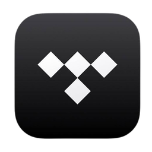

<p align="center"></p>

<h1 align="center">tidalfast</h1>

<p align="center">A fast, simple and native desktop client for TIDAL, written in Rust with <a href="https://github.com/emilk/egui">egui</a>.<br>
No Electron, no web view, just a small binary.</p>

> **Unofficial.** tidalfast is not affiliated with, endorsed by or connected to TIDAL. "TIDAL" and the TIDAL logo are trademarks of their respective owners. You need your own TIDAL subscription.

## Features

- **Best quality, always.** tidalfast requests the highest quality TIDAL offers for every track (Hi-Res Lossless → Lossless FLAC → High AAC). Hi-Res streams use DASH, which the player cannot decode yet, so in practice you get lossless FLAC. There is nothing to configure.
- **Search with link support:** search TIDAL for tracks, albums, artists and playlists, or paste a link instead. Spotify (tracks, albums, artists, playlists, `spotify:` URIs and `spotify.link` short links), YouTube / YouTube Music, TIDAL and [linkhop](https://github.com/paul-wtf/linkhop) links are converted and opened on TIDAL.
- **Library:** your playlists, liked tracks, albums and artist pages (top tracks and releases).
- **Playlist details:** edit the title, description and cover image of your own playlists (right-click a playlist or use *Edit details*); descriptions are shown on the playlist page.
- **Queue, shuffle and repeat**, with the last played track restored on startup.
- **Gapless playback or crossfade** between tracks (length adjustable).
- **10-band equalizer** with a live spectrum/meter display.
- **Lyrics and credits** for the playing track.
- **Spotify playlist import:** paste a public Spotify playlist link, tidalfast matches the songs on TIDAL and creates a TIDAL playlist from them.
- **Robust Spotify links:** track, album, artist and playlist links (also `spotify.link` short links and links inside pasted text) are converted via linkhop; if linkhop is down or doesn't know a link, tidalfast reads the Spotify page itself and matches it on TIDAL. Requests are retried automatically.
- **Link handler:** `tidal:` and `spotify:` links (for example clicked in Discord) open in the app.
- **Discord Rich Presence:** shows what you listen to, with cover, progress and an "Listen on TIDAL" button. Updates are debounced, rate-limit friendly and survive Discord restarts.
- **Media keys and desktop media controls:** play/pause/next/previous/seek from your keyboard and from the media widgets of your desktop (MPRIS on Linux: KDE, GNOME, Waybar's `mpris` module, `playerctl`; System Media Transport Controls on Windows). Shows title, artist and cover.
- **Tray icon:** StatusNotifierItem on Linux (KDE, Waybar, XFCE, … and GNOME with the AppIndicator extension), notification-area icon on Windows. Left click shows/hides the window, the menu has play/pause, next, previous and quit. Optionally keeps running in the tray when you close the window. Media keys and tray are configured in *Settings → System*.
- **Output device selection** (PipeWire/PulseAudio sinks on Linux, WASAPI devices on Windows).
- **Single instance:** starting tidalfast again focuses the running window.
- Keyboard shortcuts: `Space` play/pause, `Ctrl+→/←` next/previous, `→/←` seek ±10 s, `↑/↓` volume, `M` mute, `Ctrl+F` or `/` search.

## Install

### Linux (one line)

```sh
curl -fsSL https://raw.githubusercontent.com/wildesPepega/tidalfast/main/install.sh | bash
```

This downloads the latest release binary to `~/.local/bin/tidalfast`, and adds a menu entry, the icon and the `tidal:`/`spotify:` link handler. No root needed. Requires ALSA (`libasound`), which every desktop distribution has.

### Linux (AppImage)

Download `tidalfast-x86_64.AppImage` from the [latest release](https://github.com/wildesPepega/tidalfast/releases/latest), then:

```sh
chmod +x tidalfast-x86_64.AppImage
./tidalfast-x86_64.AppImage
```

### Windows

Download `tidalfast-windows-x86_64.exe` from the [latest release](https://github.com/wildesPepega/tidalfast/releases/latest) and run it. Signing in opens your default browser.

### Build from source

```sh
git clone https://github.com/wildesPepega/tidalfast
cd tidalfast
cargo build --release
```

The binary ends up in `target/release/tidalfast`. On Linux you need the ALSA development headers (`libasound2-dev` / `alsa-lib`). The Windows build is cross-compiled with `cargo build --release --target x86_64-pc-windows-gnu` (MinGW).

## Signing in

On first start tidalfast shows a code and opens TIDAL's device-login page in your browser. Confirm there, and the app signs in. Your tokens are stored locally in `settings.json` in your config directory (`~/.config/tidalfast/` on Linux, `%APPDATA%\tidalfast\` on Windows). Your password never touches tidalfast.

## Project layout

| File | Purpose |
| --- | --- |
| `src/main.rs` | Entry point, window and icon setup |
| `src/app.rs` | The egui application: views, queue, settings, event handling |
| `src/ui.rs` | Shared widgets and the theme |
| `src/tidal.rs` | TIDAL API client: device login, token refresh, search, library, stream resolving |
| `src/net.rs` | Background network thread that talks to the client |
| `src/audio.rs` | Playback engine (rodio/cpal): decks, downloads, device selection |
| `src/transition.rs` | Gapless/crossfade planning and the fade source |
| `src/eq.rs` | Equalizer and spectrum analysis |
| `src/discord.rs` | Discord Rich Presence worker |
| `src/import.rs`, `src/link.rs` | Spotify import and Spotify/TIDAL link parsing |
| `src/system.rs` | Media keys / MPRIS / Windows media controls and the tray icon |
| `src/ipc.rs`, `src/desktop.rs` | Single instance and Linux desktop integration |
| `src/config.rs`, `src/cache.rs`, `src/model.rs` | Settings, on-disk cache and data types |
| `install.sh` | Linux installer used by the curl command |

## Credits

- **[SONE](https://github.com/lullabyX/sone) by lullabyX**: tidalfast builds on the work of this TIDAL desktop application. The TIDAL login flow (device authorization and the client configuration) and the way streams are resolved so that music playback works are taken from SONE. Thank you!
- **[linkhop](https://github.com/paul-wtf/linkhop) by [paul-wtf](https://github.com/paul-wtf)**: the link conversion service tidalfast uses to open and share links across TIDAL, Spotify and YouTube. Thank you!
- [egui / eframe](https://github.com/emilk/egui), [rodio](https://github.com/RustAudio/rodio), [cpal](https://github.com/RustAudio/cpal), [discord-rich-presence](https://crates.io/crates/discord-rich-presence), [souvlaki](https://github.com/Sinono3/souvlaki), [ksni](https://github.com/iovxw/ksni), [tray-icon](https://github.com/tauri-apps/tray-icon), [Phosphor icons](https://phosphoricons.com/) and [reqwest](https://github.com/seanmonstar/reqwest).
- The TIDAL name and logo belong to TIDAL.

## License

[MIT](LICENSE) for the tidalfast code. TIDAL content and services are subject to TIDAL's own terms.
