<p align="center">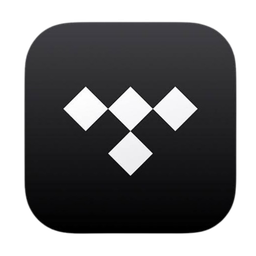</p>

<h1 align="center">Oxytide</h1>

<p align="center">A fast, simple and native desktop client for TIDAL, written in Rust with <a href="https://github.com/emilk/egui">egui</a>.<br>
No Electron, no web view, just a small binary.</p>

> **Formerly tidalfast.** Oxytide is the new name of tidalfast (0.7.0 and later). On the first start it takes over your settings, login, plugins, themes and cache from the old folders, so you do not have to sign in again; an installed tidalfast updates itself to Oxytide.

> **Unofficial.** Oxytide is not affiliated with, endorsed by or connected to TIDAL. "TIDAL" and the TIDAL logo are trademarks of their respective owners. You need your own TIDAL subscription.

## Screenshots

<p align="center">
  <a href="docs/screenshots/home.jpg">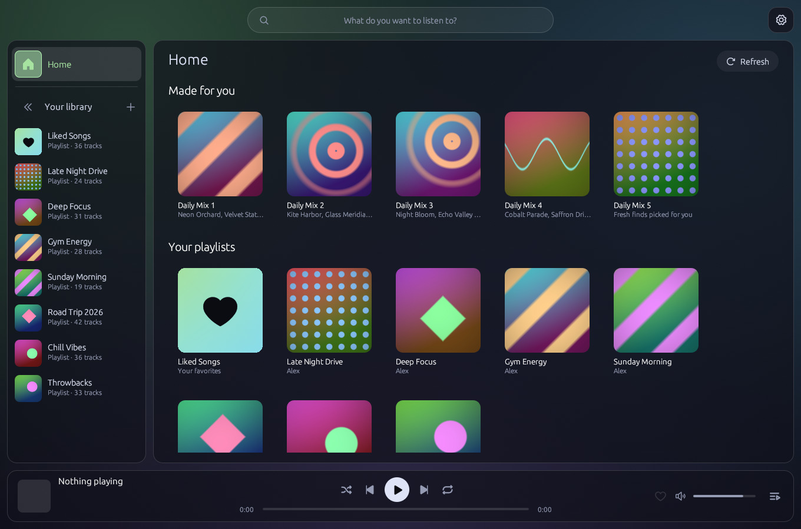</a>
  <a href="docs/screenshots/playlist.jpg">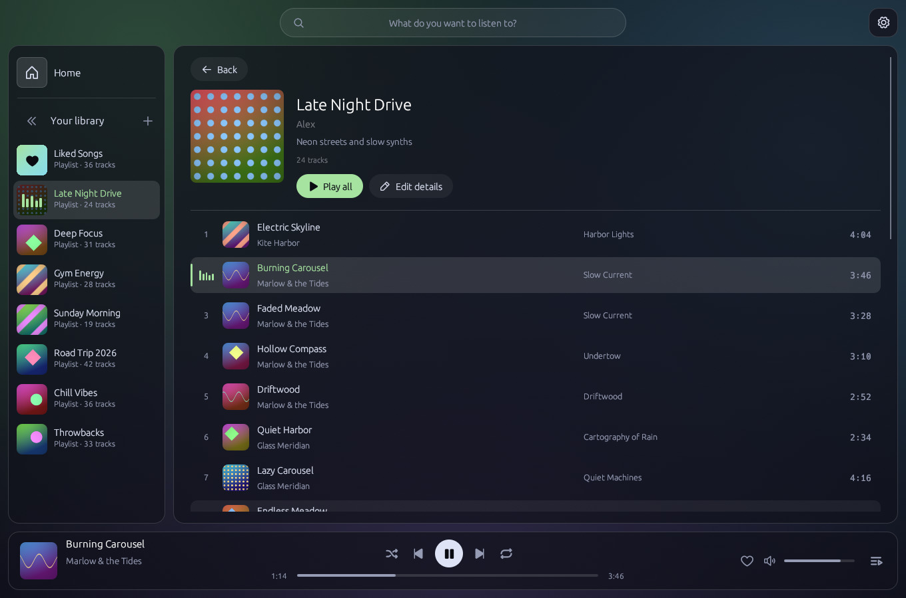</a>
  <a href="docs/screenshots/now-playing.jpg">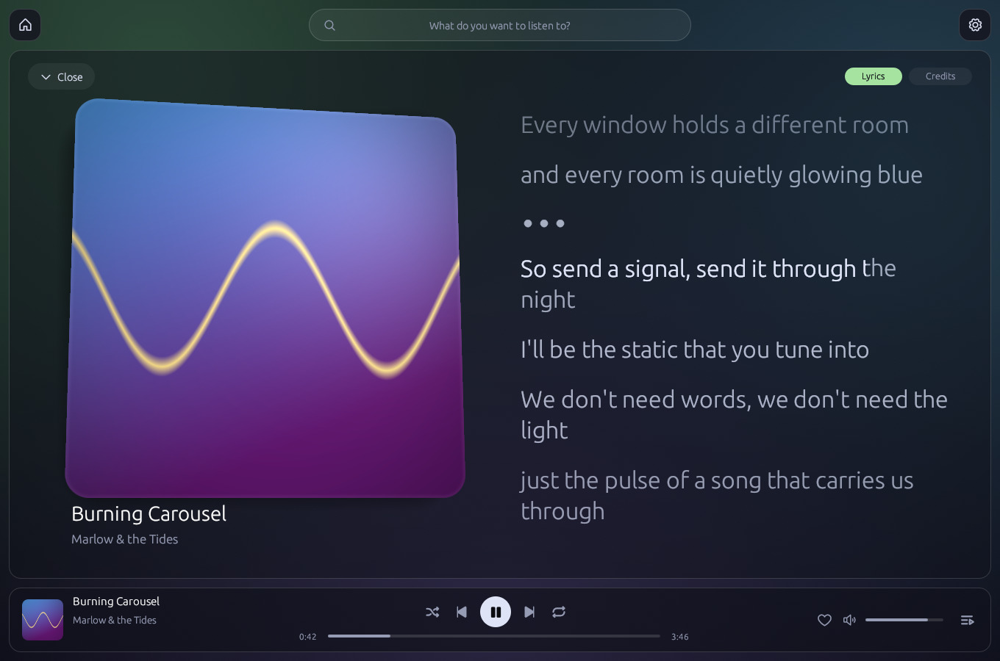</a>
  <a href="docs/screenshots/now-playing-liquid.jpg">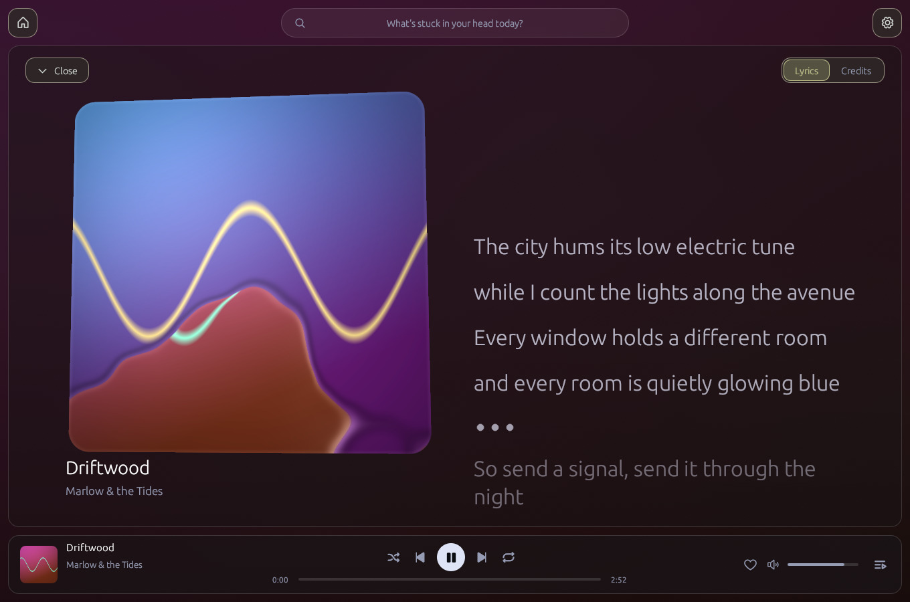</a>
  <a href="docs/screenshots/cover-effects.jpg">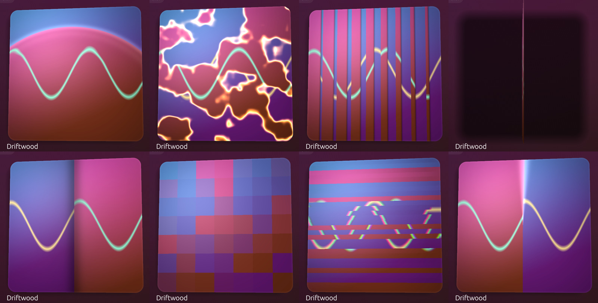</a>
  <a href="docs/screenshots/cover-explode.jpg">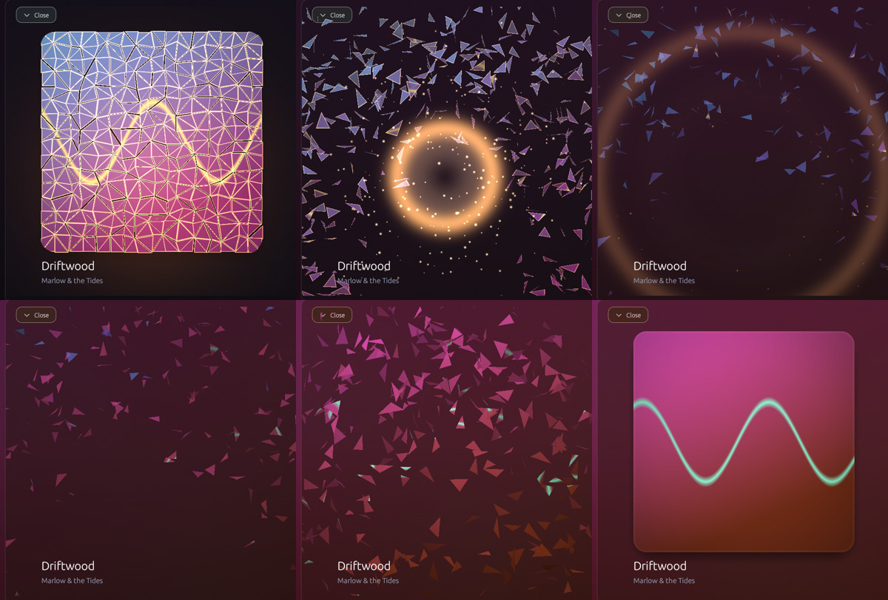</a>
  <a href="docs/screenshots/queue.jpg">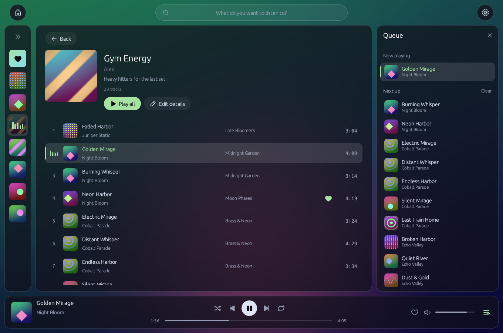</a>
  <a href="docs/screenshots/playlist-closed.jpg">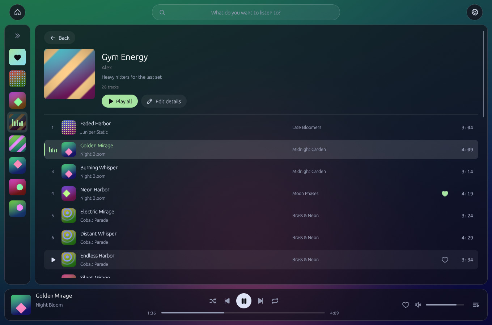</a>
  <a href="docs/screenshots/search.jpg">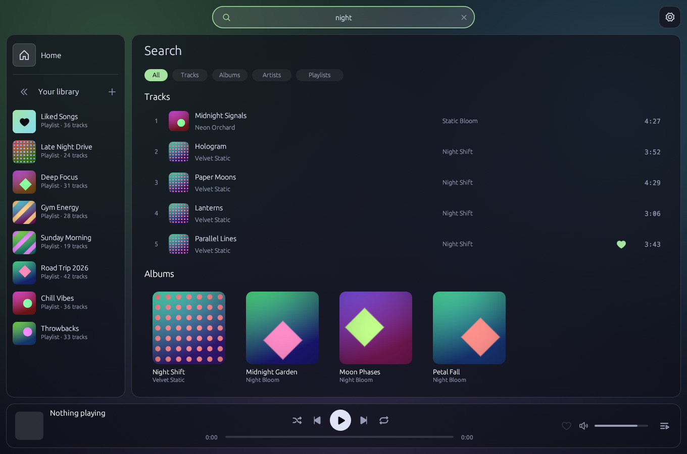</a>
  <a href="docs/screenshots/artist.jpg">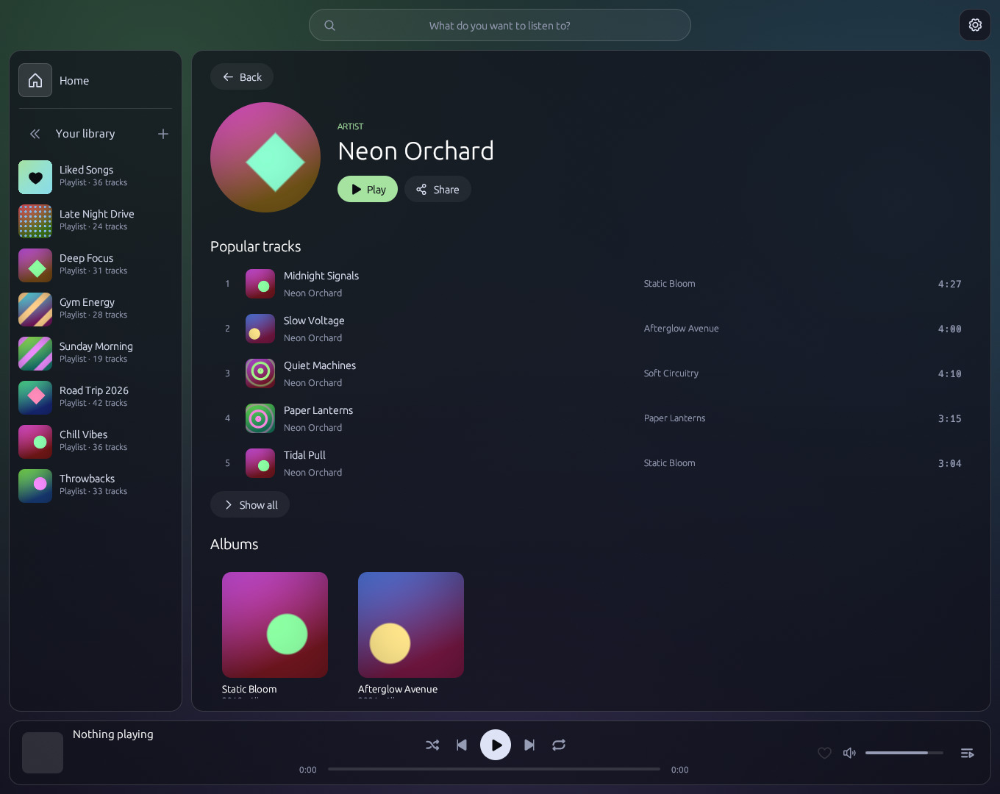</a>
  <a href="docs/screenshots/appearance.jpg">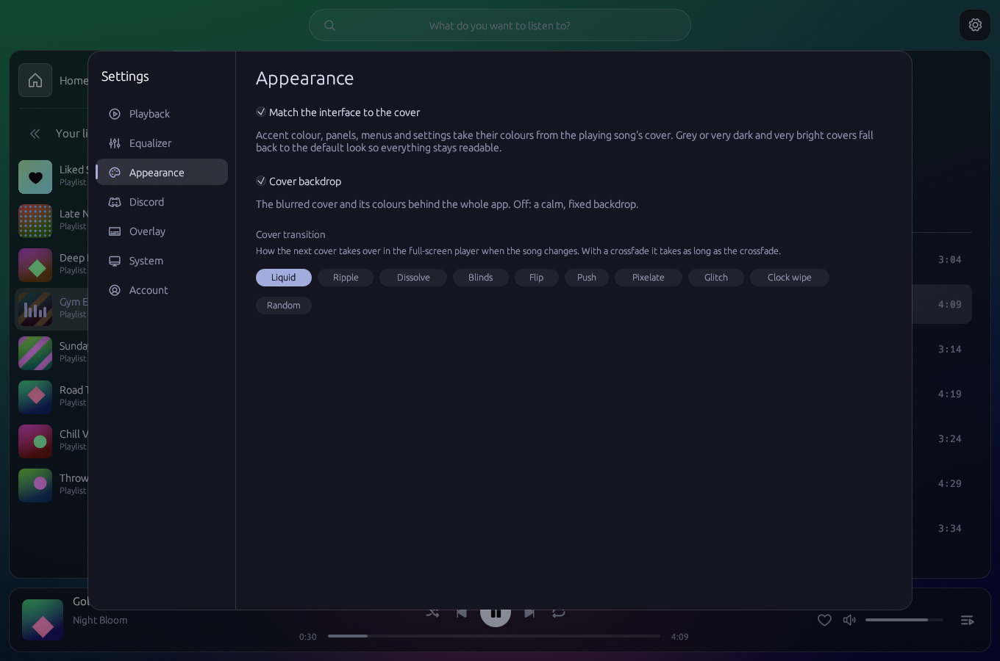</a>
  <a href="docs/screenshots/equalizer.jpg">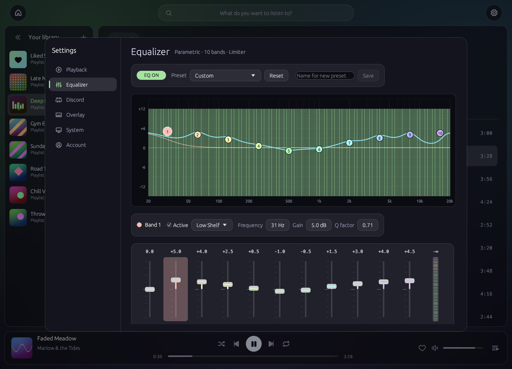</a>
  <a href="docs/screenshots/overlay.jpg">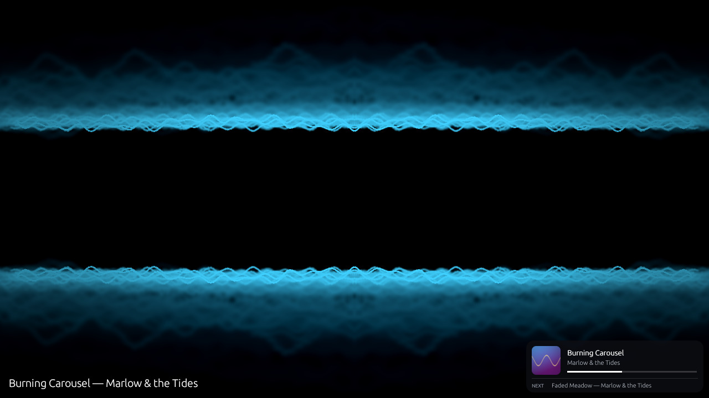</a>
</p>

<sub>Every artist, album, playlist and cover in these pictures is made up (the app's demo mode, available in debug builds with `OXYTIDE_DEMO=1`); no account or TIDAL content is shown.</sub>

## Features

- **Song cache:** songs you have played are kept on disk (up to a size you choose, 2 GB by default, oldest removed first), so they start at once next time and play without a connection. The files on disk are scrambled with a key of your installation, so they are not music files you could just open or copy around. Switch it off or clear it in *Settings → Playback*; *Settings → System* has a button that clears all caches.
- **Best quality, always.** Oxytide requests the highest quality TIDAL offers for every track (Hi-Res Lossless → Lossless FLAC → High AAC). Hi-Res streams use DASH, which the player cannot decode yet, so in practice you get lossless FLAC. There is nothing to configure.
- **Search with link support:** search TIDAL for tracks, albums, artists and playlists, or paste a link instead. Spotify (tracks, albums, artists, playlists, `spotify:` URIs and `spotify.link` short links), YouTube / YouTube Music, TIDAL and [linkhop](https://github.com/paul-wtf/linkhop) links are converted and opened on TIDAL.
- **Library:** your playlists, liked tracks, albums and artist pages (top tracks and releases).
- **Playlist details:** edit the title, description and cover image of your own playlists (right-click a playlist or use *Edit details*); descriptions are shown on the playlist page.
- **Queue, shuffle and repeat**, with the last played track restored on startup.
- **Gapless playback or crossfade** between tracks (length adjustable).
- **10-band equalizer** with a live spectrum/meter display.
- **Animated covers:** albums that have a looping video on TIDAL play it in the full-screen player, and the backdrop moves along with it (switch off in *Settings → Appearance*).
- **Theme from the cover:** the accent colour, the glass panels, menus and settings take their colours from the playing song's cover, with a fallback to the default look for grey, very dark or very bright covers so everything stays readable. Both the interface colours and the blurred cover backdrop can be switched off in *Settings → Appearance*.
- **Full-screen player:** the cover is a 3D plate that tilts towards your mouse; when the song changes, the next cover takes over with an effect (liquid, ripple, dissolve, blinds, flip, push, pixelate, glitch, clock wipe, wave (after Radiant Lyrics), ink, a full-on explosion where the cover blows up into shards and builds itself up again as the new one, or a random one per song), lasting as long as your crossfade. Choose it in *Settings → Appearance*, where you can also switch on a reflection under the cover, a holo foil sheen that follows the mouse, a fluid colour-field backdrop and a glowing sung word with depth blur and an adjustable timing offset in the lyrics (all optional). Synced lyrics are karaoke-style: the line being sung is bright, its words fill in as they are sung, and the column glides along (click a line to jump there). Credits are one tab away.
- **Spotify playlist import:** paste a public Spotify playlist link, Oxytide matches the songs on TIDAL and creates a TIDAL playlist from them.
- **Robust Spotify links:** track, album, artist and playlist links (also `spotify.link` short links and links inside pasted text) are converted via linkhop; if linkhop is down or doesn't know a link, Oxytide reads the Spotify page itself and matches it on TIDAL. Requests are retried automatically.
- **Link handler:** `tidal:` and `spotify:` links (for example clicked in Discord) open in the app.
- **Discord Rich Presence:** shows what you listen to (title and artist, and whether it is a single, `EP: name` or `Album: name`), with cover, progress and a "Listen on TIDAL" button; optionally it stays while paused. All texts can be your own: fields in *Settings → Discord* take templates with variables such as `{title}`, `{artist}`, `{album}`, `{release}`, `{year}`, `{tracks}`, `{duration}` and `{quality}`, with a live preview. Updates are debounced, rate-limit friendly and survive Discord restarts.
- **Media keys and desktop media controls:** play/pause/next/previous/seek from your keyboard and from the media widgets of your desktop (MPRIS on Linux: KDE, GNOME, Waybar's `mpris` module, `playerctl`; System Media Transport Controls on Windows). Shows title, artist and cover.
- **Tray icon:** StatusNotifierItem on Linux (KDE, Waybar, XFCE, … and GNOME with the AppIndicator extension), notification-area icon on Windows. Left click shows/hides the window, the menu has play/pause, next, previous and quit. Optionally keeps running in the tray when you close the window. Media keys and tray are configured in *Settings → System*.
- **Updates:** checks GitHub for new releases (at startup and every few hours) and can download, verify (SHA-256) and install them itself, for the Linux binary, the AppImage and Windows; *Settings → System → Updates* has a switch for the check and for automatic installation.
- **Now-playing overlay:** an optional local web page (cover, title, artist, progress, bottom left, transparent) for recordings and streams, served on `127.0.0.1` and used as a browser source; switch it on in *Settings → Overlay*. There is also a read-only JSON API on the same local server (`/api/now` with the current and next track, cover, progress; `/api/cover` for the picture), which you can switch on and off separately. On Linux, a built-in plugin for [GPU Screen Recorder](https://git.dec05eba.com/gpu-screen-recorder/about/) draws the same card (with the next track) into the bottom right of your recordings and replays, only while music plays; install it with one click in *Settings → Overlay* (source in `gsr-plugin/`).
- **Output device selection** (PipeWire/PulseAudio sinks on Linux, WASAPI devices on Windows).
- **Single instance:** starting Oxytide again focuses the running window.
- Keyboard shortcuts: `Space` play/pause, `Ctrl+→/←` next/previous, `→/←` seek ±10 s, `↑/↓` volume, `M` mute, `Ctrl+F` or `/` search.

## Install

### Linux (one line)

```sh
curl -fsSL https://raw.githubusercontent.com/wildesPepega/oxytide/main/install.sh | bash
```

This downloads the latest release binary to `~/.local/bin/oxytide`, and adds a menu entry, the icon and the `tidal:`/`spotify:` link handler. No root needed. Requires ALSA (`libasound`), which every desktop distribution has.

### Linux (AppImage)

Download `oxytide-x86_64.AppImage` from the [latest release](https://github.com/wildesPepega/oxytide/releases/latest), then:

```sh
chmod +x oxytide-x86_64.AppImage
./oxytide-x86_64.AppImage
```

### Windows

Download `oxytide-windows-x86_64.exe` from the [latest release](https://github.com/wildesPepega/oxytide/releases/latest) and run it. Signing in opens your default browser.

### Build from source

```sh
git clone https://github.com/wildesPepega/oxytide
cd oxytide
cargo build --release
```

The binary ends up in `target/release/oxytide`. `oxytide --register` adds the application-menu entry and icon. Debug builds have a demo mode for screenshots: `OXYTIDE_DEMO=1` swaps TIDAL for made-up music (use throwaway `XDG_CONFIG_HOME`, `XDG_CACHE_HOME` and `XDG_DATA_HOME` so your settings stay untouched), `OXYTIDE_SHOT=out.png` with `OXYTIDE_SHOT_OPEN`, `_PLAY`, `_NOW`, `_QUEUE`, `_SEARCH`, `_ARTIST`, `_SETTINGS` and `_TAB` saves a picture of the window. On Linux you need the ALSA development headers (`libasound2-dev` / `alsa-lib`). The Windows build is cross-compiled with `cargo build --release --target x86_64-pc-windows-gnu` (MinGW).

## Signing in

On first start Oxytide shows a code and opens TIDAL's device-login page in your browser. Confirm there, and the app signs in. Your tokens are stored locally in `settings.json` in your config directory (`~/.config/oxytide/` on Linux, `%APPDATA%\oxytide\` on Windows). Your password never touches Oxytide.

## Project layout

| File | Purpose |
| --- | --- |
| `src/main.rs` | Entry point, window and icon setup |
| `src/app.rs` | The egui application: views, queue, settings, event handling |
| `src/ui.rs` | Shared widgets and the theme |
| `src/tidal.rs` | TIDAL API client: device login, token refresh, search, library, stream resolving |
| `src/net.rs` | Background network thread that talks to the client |
| `src/audio.rs` | Playback engine (rodio/cpal): decks, downloads, device selection |
| `src/transition.rs` | Gapless/crossfade planning and the fade source |
| `src/eq.rs` | Equalizer and spectrum analysis |
| `src/discord.rs` | Discord Rich Presence worker |
| `src/presence.rs` | The status texts: templates, variables, release type |
| `src/import.rs`, `src/link.rs` | Spotify import and Spotify/TIDAL link parsing |
| `src/demo.rs` | Debug builds only: the made-up music behind the screenshots |
| `gsr-plugin/` | C plugin for GPU Screen Recorder that draws the overlay card into recordings |
| `src/overlay.rs`, `src/card.rs` | The optional now-playing overlay: a small localhost web server with a transparent page and a JSON endpoint |
| `src/system.rs` | Media keys / MPRIS / Windows media controls and the tray icon |
| `src/ipc.rs`, `src/desktop.rs` | Single instance and Linux desktop integration |
| `src/config.rs`, `src/cache.rs`, `src/model.rs` | Settings, on-disk cache and data types |
| `install.sh` | Linux installer used by the curl command |

## Plugins and themes

Oxytide can be extended with **plugins** (small scripts in a sandbox that add buttons, menu entries and settings, react to the music and can even hide or change built-in parts) and **themes** (a colour file, no code). Plugins never run until you have seen what they ask for and allowed it; they cannot touch your files, start programs or see your TIDAL account. See [API.md](API.md) for the full reference (including the security model), and [`examples/`](examples/) for plugins and themes to start from. *Settings → Plugins* and *Settings → Appearance → Theme* manage them.

## Credits

- **[SONE](https://github.com/lullabyX/sone) by lullabyX**: Oxytide builds on the work of this TIDAL desktop application. The TIDAL login flow (device authorization and the client configuration) and the way streams are resolved so that music playback works are taken from SONE. Thank you!
- **[linkhop](https://github.com/paul-wtf/linkhop) by [paul-wtf](https://github.com/paul-wtf)**: the link conversion service Oxytide uses to open and share links across TIDAL, Spotify and YouTube. Thank you!
- [egui / eframe](https://github.com/emilk/egui), [rodio](https://github.com/RustAudio/rodio), [cpal](https://github.com/RustAudio/cpal), [discord-rich-presence](https://crates.io/crates/discord-rich-presence), [souvlaki](https://github.com/Sinono3/souvlaki), [ksni](https://github.com/iovxw/ksni), [tray-icon](https://github.com/tauri-apps/tray-icon), [Phosphor icons](https://phosphoricons.com/) and [reqwest](https://github.com/seanmonstar/reqwest), and [OpenH264](https://github.com/cisco/openh264) (via the [openh264](https://crates.io/crates/openh264) crate, built from source) with the [mp4](https://crates.io/crates/mp4) crate for the animated covers, and [Rhai](https://rhai.rs) for plugins. H.264 can be subject to patent licensing in some countries; if that matters to you, switch off *Animated covers* and build without them.
- **[Radiant Lyrics](https://radiant-lyrics.org) by [meowarex](https://github.com/meowarex/TidaLuna-Plugins)**: the *Wave* cover transition (a glowing wave with ripples sweeping across the cover) is a port of its cover swap shader, which in turn is based on the DJ cover transitions by [visiuun](https://github.com/visiuun/tidaluna-plugins). Based on [Radiant Lyrics](https://radiant-lyrics.org) by meowarex. Thank you!
- The TIDAL name and logo belong to TIDAL.

## License

[GPL-3.0](LICENSE) for the Oxytide code (up to and including 0.6.6 it was MIT; it changed because the *Wave* transition is derived from the GPL-3.0 project Radiant Lyrics, see Credits). TIDAL content and services are subject to TIDAL's own terms.
